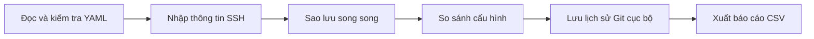

# Hệ thống sao lưu cấu hình và quản lý thiết bị mạng

**Network Configuration Backup & Inventory** — Đồ án môn học **Quản trị mạng nâng cao**.

Ứng dụng Python giúp quản lý danh sách thiết bị, sao lưu cấu hình qua SSH, phát hiện thay đổi và lưu lịch sử bằng Git. Dự án phục vụ thực hành tự động hóa quản trị mạng với mô hình Cisco IOS trên GNS3.

**Bản nâng cấp đã tích hợp:** scheduler, dashboard Streamlit, lọc secret trước khi lưu, kiểm tra IP/SSH host key, lệnh riêng cho Juniper và demo offline tách biệt. Xem [INTEGRATION.md — hướng dẫn chạy đầy đủ](INTEGRATION.md).

Chạy thử không cần router:

```powershell
.\.venv\Scripts\python.exe -m pip install -r requirements.txt
.\.venv\Scripts\python.exe -X utf8 -m src.scheduler --once --demo
.\.venv\Scripts\python.exe -m streamlit run dashboard.py --server.address 127.0.0.1
```

Mở http://localhost:8501, chọn **Demo**. Chạy thật cần `.env`, allowlist và SSH host key đã xác minh; các bước bên dưới phải được thực hiện cùng hướng dẫn bảo mật trong INTEGRATION.md.

## Thành viên nhóm

| STT | Họ và tên | Mã số sinh viên |
| --- | --- | --- |
| 1 | Lê Ngọc Thuận | 1250080192 |
| 2 | Lê Thanh Tính | 1250080199 |
| 3 | Dương Minh Triết | 1250080211 |

## Mục lục

- [Chức năng chính](#chức-năng-chính)
- [Quy trình hoạt động](#quy-trình-hoạt-động)
- [Mô hình thử nghiệm](#mô-hình-thử-nghiệm)
- [Cài đặt và sử dụng](#cài-đặt-và-sử-dụng)
- [Kết quả và lịch sử cấu hình](#kết-quả-và-lịch-sử-cấu-hình)
- [Cấu trúc dự án](#cấu-trúc-dự-án)
- [Kiểm thử](#kiểm-thử)
- [Xử lý sự cố](#xử-lý-sự-cố)
- [Bảo vệ dữ liệu](#bảo-vệ-dữ-liệu)
- [Phạm vi và hướng phát triển](#phạm-vi-và-hướng-phát-triển)

## Chức năng chính

| Chức năng | Mô tả |
| --- | --- |
| Quản lý thiết bị | Đọc danh sách từ YAML; kiểm tra tên, địa chỉ IP, loại thiết bị và cổng SSH; phát hiện tên hoặc địa chỉ kết nối trùng lặp. |
| Sao lưu qua SSH | Netmiko dùng lệnh riêng Cisco IOS / Juniper Junos, kiểm tra IP allowlist và host key. |
| Xử lý song song | Sao lưu nhiều thiết bị bằng `ThreadPoolExecutor`; chương trình chính sử dụng tối đa 3 luồng. |
| So sánh cấu hình | So sánh hai bản sao lưu gần nhất và hiển thị các dòng thay đổi bằng `difflib`. |
| Lưu lịch sử | Tự tạo kho Git cục bộ cho cấu hình; chỉ tạo commit khi nội dung khác phiên bản đã lưu. |
| Báo cáo | Xuất kết quả theo thiết bị ra CSV/JSON, lưu trạng thái diff/Git và loại lỗi. |
| Lập lịch | APScheduler chạy hằng ngày theo múi giờ, timeout và khóa chống trùng lượt. |
| Dashboard | Streamlit xem trạng thái và kích hoạt backup Demo hoặc thiết bị thật; chế độ thật yêu cầu xác nhận allowlist/SSH host key và có thể dùng thông tin xác thực nhập theo phiên hoặc `.env`. |
| Lọc secret | Che thông tin nhạy cảm trước khi lưu backup, diff và Git. |

**Công nghệ:** Python, Netmiko, PyYAML, Git và các thư viện chuẩn của Python (`concurrent.futures`, `difflib`, `csv`, `logging`, `unittest`).

## Quy trình hoạt động



Mỗi thiết bị có kết quả xử lý riêng. Khi một thiết bị sao lưu thất bại, chương trình bỏ qua bước so sánh và lưu Git của thiết bị đó, đồng thời tiếp tục xử lý các thiết bị còn lại.

## Mô hình thử nghiệm

```text
Máy Windows chạy Python (192.168.36.1)
                  |
             VMware VMnet1
                  |
              GNS3 Cloud
                  |
               SW-MGMT
              /       \
         R1-CISCO    R2-CISCO
      192.168.36.11  192.168.36.12
          SSH 22        SSH 22
```

| Thiết bị | Địa chỉ quản trị | Nền tảng | Cổng SSH |
| --- | --- | --- | --- |
| R1-CISCO | 192.168.36.11 | Cisco 3725 / Cisco IOS | 22 |
| R2-CISCO | 192.168.36.12 | Cisco 3725 / Cisco IOS | 22 |

Các địa chỉ trên thuộc mạng thử nghiệm. Khi sử dụng mô hình khác, cần cập nhật địa chỉ và cấu hình kết nối tương ứng.

Tài liệu chi tiết: [Thiết lập mạng GNS3](network/gns3-topology/network-setup.md) · [Kế hoạch địa chỉ IP](network/gns3-topology/ip-addressing.md).

## Cài đặt và sử dụng

### 1. Chuẩn bị môi trường

- Python 3.9 trở lên; chọn phiên bản Netmiko và PyYAML tương thích với Python đang dùng.
- Git có trong `PATH` của máy chạy chương trình.
- Thiết bị Cisco IOS đã bật SSH và tài khoản có quyền chạy `show running-config`.
- Kết nối mạng từ máy chạy Python đến địa chỉ quản trị của thiết bị.
- GNS3 và VMware nếu sử dụng mô hình thử nghiệm của dự án.

Các lệnh dưới đây sử dụng **PowerShell trên Windows** và được chạy tại thư mục gốc dự án.

### 2. Tải mã nguồn và cài thư viện

```powershell
git clone --branch develop https://github.com/Jonny-Pak/network-config-backup-inventory.git
cd network-config-backup-inventory
python -m venv .venv
.\.venv\Scripts\python.exe -m pip install -r requirements.txt
git --version
```

Các bước tiếp theo gọi trực tiếp Python trong môi trường ảo, không cần kích hoạt môi trường bằng script PowerShell.

### 3. Cấu hình danh sách thiết bị

Chỉnh sửa [config/devices.yaml](config/devices.yaml):

```yaml
devices:
  - name: R1-CISCO
    host: 192.168.36.11
    device_type: cisco_ios
    port: 22

  - name: R2-CISCO
    host: 192.168.36.12
    device_type: cisco_ios
    port: 22
```

| Trường | Quy tắc |
| --- | --- |
| `name` | Bắt buộc, duy nhất; chỉ gồm chữ cái không dấu, chữ số, dấu gạch ngang hoặc gạch dưới. |
| `host` | Bắt buộc, là địa chỉ IPv4 hoặc IPv6 hợp lệ. |
| `device_type` | Bắt buộc; mô hình hiện tại sử dụng `cisco_ios`. |
| `port` | Số nguyên từ 1 đến 65535; mặc định là `22` nếu bỏ qua. |

Không khai báo trùng cặp `host` và `port`. Các trường bổ sung như `vendor`, `model`, `location` có thể dùng để mô tả thiết bị.

Kiểm tra danh sách trước khi kết nối:

```powershell
.\.venv\Scripts\python.exe .\src\inventory.py
```

### 4. Kiểm tra kết nối SSH

Khởi động router, kiểm tra địa chỉ IP, trạng thái giao diện quản trị và cấu hình xác thực SSH. Sau đó kiểm tra cổng TCP:

```powershell
Test-NetConnection 192.168.36.11 -Port 22
Test-NetConnection 192.168.36.12 -Port 22
```

`TcpTestSucceeded : True` cho biết cổng có thể truy cập; kết quả này chưa xác nhận thông tin đăng nhập SSH hợp lệ.

### 5. Chạy chương trình

Trước khi chạy thật, sao chép `.env.example` thành `.env`, đặt `BACKUP_ALLOWED_CIDRS` và xác minh fingerprint/đăng ký key vào known_hosts theo [INTEGRATION.md](INTEGRATION.md). Chạy lịch tự động bằng `python -m src.scheduler`; scheduler cần thông tin đăng nhập trong `.env` hoặc biến môi trường.

```powershell
.\.venv\Scripts\python.exe -X utf8 -m src.main
```

Chương trình hiển thị danh sách thiết bị và yêu cầu nhập tên đăng nhập, mật khẩu SSH. Một bộ thông tin đăng nhập được sử dụng cho các thiết bị trong lần chạy đó.

Sau khi hoàn tất, màn hình hiển thị kết quả từng thiết bị và đường dẫn báo cáo JSON/CSV. Mã lỗi `1` báo lỗi backup/diff/Git/báo cáo; mã `2` báo đã có một lượt chạy khác.

## Kết quả và lịch sử cấu hình

### Dữ liệu được tạo

| Thư mục | Nội dung |
| --- | --- |
| `backups/` | Bản đã lọc secret theo thiết bị và thời điểm, timestamp có microsecond. |
| `config_history/` | Kho Git cục bộ riêng, lưu cấu hình hiện tại của từng thiết bị trong tệp `<tên-thiết-bị>.cfg`. |
| `reports/` | CSV UTF-8 BOM, `latest.json`, lịch sử `run_*.json` và `scheduler_status.json`. |
| `demo/` | Dữ liệu offline riêng, gồm backups, config_history và reports. |
| `logs/` | Nhật ký JSON từng lượt, chỉ gồm dữ liệu và lỗi đã xử lý. |

### Trạng thái so sánh cấu hình

| Trạng thái | Ý nghĩa |
| --- | --- |
| `FIRST_BACKUP` | Mới có một bản sao lưu, chưa có phiên bản trước để so sánh. |
| `CHANGED` | Hai bản sao lưu gần nhất có nội dung khác nhau. |
| `UNCHANGED` | Hai bản sao lưu gần nhất giống nhau. |
| `NO_BACKUP` | Không tìm thấy bản sao lưu của thiết bị. |
| `SKIPPED` | Bỏ qua so sánh vì sao lưu thất bại. |
| `ERROR` | Có lỗi trong quá trình so sánh. |

Bước lưu Git so sánh bản sao lưu với cấu hình hiện tại trong `config_history/`. Trạng thái `COMMITTED` cho biết đã tạo phiên bản mới; `UNCHANGED` cho biết không cần tạo commit.

Tra cứu lịch sử toàn bộ cấu hình hoặc riêng một thiết bị:

```powershell
git -C config_history log --oneline
git -C config_history log --oneline -- R1-CISCO.cfg
```

Kho lịch sử cấu hình được khởi tạo với danh tính `Network Backup Bot`. Chương trình chỉ lưu lịch sử cục bộ, không tự động đẩy cấu hình lên GitHub.

### Báo cáo CSV

Mỗi dòng tương ứng một thiết bị, gồm các cột:

```csv
Device,IP,Backup Status,Change Status,Git Status,Commit,Error
R1-CISCO,192.168.36.11,SUCCESS,CHANGED,COMMITTED,<ma-commit>,
R2-CISCO,192.168.36.12,SUCCESS,UNCHANGED,UNCHANGED,,
```

Ví dụ trên minh họa cấu trúc báo cáo. Cột `Commit` chứa mã phiên bản mới nếu có; cột `Error` ghi thông tin lỗi khi xử lý thiết bị.

## Cấu trúc dự án

```text
network-config-backup-inventory/
├── config/
│   └── devices.yaml          # Danh sách và thông tin thiết bị
├── src/
│   ├── main.py               # Điều phối quy trình
│   ├── inventory.py          # Đọc và kiểm tra YAML
│   ├── ssh_connector.py      # Xác thực và kết nối SSH
│   ├── backup_manager.py     # Sao lưu nhiều thiết bị
│   ├── config_diff.py        # So sánh nội dung cấu hình
│   ├── change_detector.py    # Phát hiện thay đổi giữa các bản sao lưu
│   ├── git_manager.py        # Quản lý lịch sử Git cục bộ
│   ├── report_manager.py     # Xuất báo cáo CSV
│   └── logger_config.py      # Cấu hình nhật ký
├── tests/                    # Kiểm thử tự động và dữ liệu mẫu
├── network/gns3-topology/     # Tài liệu mô hình mạng
├── .gitignore
└── README.md
```

Ngoài các mô-đun chính, `src/` còn có các script hỗ trợ kiểm tra và sao lưu: `backup.py`, `test_connection.py`, `test_ssh.py`.

## Kiểm thử

Chạy bộ kiểm thử tự động:

```powershell
.\.venv\Scripts\python.exe -m unittest discover -s tests -v
```

Các nhóm kiểm thử bao gồm: kiểm tra danh sách thiết bị, quản lý sao lưu, so sánh cấu hình, phát hiện thay đổi, lưu lịch sử Git và xuất CSV. Các bài kiểm thử dùng dữ liệu mẫu hoặc mô phỏng kết nối; cần kiểm tra riêng với router GNS3 để đánh giá kết nối SSH thực tế.

## Xử lý sự cố

| Hiện tượng | Nội dung cần kiểm tra |
| --- | --- |
| Không tìm thấy thư viện Python | Cài Netmiko và PyYAML bằng đúng Python trong `.venv`. |
| Danh sách thiết bị không hợp lệ | Kiểm tra cấu trúc YAML, tên duy nhất, địa chỉ IP, loại thiết bị và cổng SSH. |
| SSH hết thời gian chờ | Kiểm tra router đã chạy, giao diện quản trị, định tuyến, tường lửa và cổng SSH. |
| Xác thực SSH thất bại | Kiểm tra tài khoản, mật khẩu và cấu hình xác thực trên router. |
| Cấu hình trả về rỗng hoặc báo lỗi | Kiểm tra quyền tài khoản và khả năng thực thi lệnh `show running-config`. |
| Lỗi lưu lịch sử Git | Kiểm tra `git --version`, quyền ghi vào `config_history/` và thông báo lỗi trong nhật ký. |

## Bảo vệ dữ liệu

Thông tin đăng nhập lấy từ `.env`/biến môi trường hoặc nhập khi chạy tương tác; không đưa mật khẩu vào mã nguồn hoặc danh sách thiết bị. Backup mới được lọc secret để đọc/diff, không đủ để khôi phục đầy đủ thiết bị. Bộ lọc theo mẫu không nhận diện chắc chắn mọi bí mật. Backup và lịch sử Git cũ chưa được chỉnh sửa; cần kiểm tra trước khi chia sẻ.

Các thư mục `backups/`, `config_history/`, `reports/`, `logs/` và các tệp bí mật được loại trừ qua `.gitignore`. Quy tắc này không loại bỏ dữ liệu đã được Git theo dõi từ trước; cần kiểm tra nội dung trước khi commit hoặc chia sẻ.

## Phạm vi và hướng phát triển

Mô hình thật hiện có hai Cisco IOS trong GNS3. Adapter Juniper đã dùng lệnh `show configuration | display set | no-more`, nhưng chưa kiểm thử Junos thật. Demo có ba thiết bị mẫu Cisco/Juniper và dữ liệu tách trong `demo/`.

Các hướng phát triển dự kiến:

- Gửi cảnh báo kết quả và kiểm chứng trên nhiều image thiết bị thật.
- Kho backup gốc mã hóa và khôi phục cấu hình.
- Đánh giá hiệu năng với số lượng thiết bị lớn hơn và bổ sung quản lý bí mật.

Mã nguồn được quản lý tại [GitHub của dự án](https://github.com/Jonny-Pak/network-config-backup-inventory); nhánh `develop` chứa các chức năng đã tích hợp.
